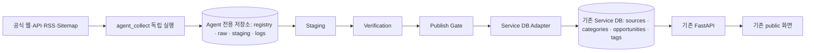

# Agent Collect Architecture — through PHASE 10 foundation

Runtime update (2026-10-04): Agent migration 008 is applied; a reviewed,
temporarily enabled Conference query completed one guarded Tavily search and
was disabled again. Four-worker Automation was exercised in DB-backed dry-run
mode only. No unattended Automation, Source auto-approval, or Service publish
was enabled. The DB backoff and duplicate Query guards were also verified in
rollback-only SQL tests. See `DISCOVERY_SCHEDULING.md` for the runtime record.

PHASE 10 orders independent Discovery → Collection → Processing → Publish
queues under the existing one-shot Automation global lease. Discovery runs
reviewed Conference queries with DB-server-time claim/lease and the existing
Tavily SearchBudgetGuard/cooldown. Promotion creates at most an inactive
`CANDIDATE` Source; a human must approve/activate it before Collection.
Defaults remain off. No daemon or LangGraph graph was added. Agent-only
migration 008 is applied and Discovery scheduling runtime-verified; unattended
Automation remains disabled. See `DISCOVERY_SCHEDULING.md` and
`AUTOMATION_RUNTIME.md`.

Historical PHASE 9 notes below describe the earlier foundation milestone;
007 was subsequently applied and runtime-verified.

PHASE 9 adds an Agent-only claimed Publish Worker and a one-shot Automation
Control Plane. Collection → Processing → Publish remain independent queues.
Only a VERIFIED/PUBLISH_READY/READY snapshot passes through the existing
ServiceDBAdapter; `REVIEW_REQUIRED` is never auto-promoted. Global and
per-worker flags default off. 007 is written but unapplied, and the live queue
has no READY item, so no Service INSERT or Backend new-row E2E is claimed.
See `docs/PUBLISH_WORKER.md` and `docs/AUTOMATION_RUNTIME.md`.

Current status (2026-10-04): 005 and 006 are applied. PHASE 8 adds selectable local/private Supabase RawContentStorage and a one-shot ProcessingWorker. The private bucket and a newly collected RawDocument passed live cross-process readback/hash checks. Processing DB claim, lease, failure completion, version seeding and privileges passed live checks; the single live Worker pass stopped fail-closed at `CROSS_RAW_CACHE` on content already extracted from another RawDocument, while the daily LLM budget was 5/5. Therefore live Candidate→Normalization→Quality Gate E2E and success-terminal behavior are still unverified. No Service DB publish was called. Details: `docs/RAW_STORAGE.md` and `docs/PROCESSING_WORKER.md`. Historical 005/006-unapplied text below is superseded.

기준: `codex_tasks.md`와 PHASE 2~7 결정. Source Registry, 범용 수집, Tavily Discovery, Conference Extraction Foundation이 구현됐다. 실제 Tavily 검색과 Supabase Query→Result→Candidate를 확인했으며 Discovery Source 자동 승격은 조건 미충족으로 0건이었다. 별도 수동 공개 Conference Source의 Collection→RawDocument→LLM Extraction→Agent Candidate E2E를 확인했다. LangGraph 전체 실행과 실제 서비스 DB 게시는 아직 없다. 세부 내용은 `docs/COLLECTION_ENGINE.md`, `docs/DISCOVERY_ENGINE.md`, `docs/EXTRACTION_ENGINE.md`에 있다.

PHASE 6에는 Agent 후보의 검증값을 읽는 Dedup, Source/Raw/evidence 검증, 결정적 Publish Gate와 Agent 전용 verification/queue persistence가 추가됐다. 실제 5건은 최종 `UNIQUE` 4/`POSSIBLE_DUPLICATE` 1/`REVIEW_REQUIRED` 5였으며 Queue 0건이다. Service DB는 별도 `adapters/service_db/duplicate_lookup.py`에서 Opportunity 5개 컬럼만 SELECT하고 게시하지 않았다. 정책·검증 범위는 `docs/QUALITY_GATE.md`를 따른다.

PHASE 7에는 `PublishCandidate v1`의 Service 매핑, Dry Run, 날짜·timezone·공개 상태 정책, 최종 충돌 검사와 ServiceDBAdapter 실제 구현이 추가됐다. 기본 publish flag는 비활성이다. 기존 5건의 실DB 평가에서 적격 후보·queue가 0건이라 Service INSERT는 0건이며 실제 게시 E2E는 미검증이다. 자세한 계약은 `docs/SERVICE_PUBLISH.md`.

PHASE 7.3A에는 검증된 추출값 → 결정적 temporal normalization → Agent Candidate 저장 경계를 수동 Runner로 추가했다. Quality Gate는 정규화 상태를 조기 REVIEW에서도 진단한다. 기존 Candidate 소급 처리와 Service 게시 E2E는 여전히 하지 않았다. 세부 계약은 `docs/NORMALIZATION_ENGINE.md`.

PHASE 7.3B에는 사람 검토·source_type 판단·승인·활성화의 명시적 계약, append-only Agent 감사 이벤트와 원자적 전이 RPC migration 004, Discovery 공식성 신호의 별도 provenance, 직접 활성화 우회 차단, 승인 Source의 읽기 전용 Service identity preview를 추가했다. 004는 2026-10-04 실DB에 적용·검증했고 기존 Source 5건은 변경하지 않았다. `docs/SOURCE_APPROVAL.md` 참조.

## 1. 전체 시스템 아키텍처와 소유권



새 Agent는 `collect/`나 `api/opportunities.py`를 import하지 않는다. 통합 지점은 `docs/DATA_CONTRACT.md`의 PublishCandidate와 Adapter다. Agent의 원문·판단·로그는 Agent 저장소가 소유한다. 기존 서비스 테이블에는 검증된 게시 결과만 기록한다. 기존 Collect와의 병행 운영이나 마이그레이션은 신규 설계 범위에 포함하지 않는다.

## 2. 권장 위치와 폴더 구조

```text
agent_collect/
  schemas/                      # PHASE 2: 도메인 모델·상태·검증
  workflows/                    # PHASE 2: AgentCollectState·Node Contract
  adapters/service_db/          # 게시 인터페이스 + PHASE 6 중복 조회 + PHASE 7 Service 매핑·쓰기 경계
  config/                       # PHASE 2: 기본 정책 TOML·환경변수 override
  migrations/                   # 001/002/003 실제 적용; 004 Source review는 작성만 함
  agents/                       # 향후 판단 로직
  collectors/                   # PHASE 3: HTML/RSS/API, Planner, Runner, 보안 transport
  storage/                      # PHASE 3: RawContentStorage, LocalRawContentStorage
  repositories/                 # PHASE 3: Agent DB 포트, Supabase/메모리 구현
  registry/                     # Source 등록·URL 정규화 + PHASE 7.3B human approval
  discovery/                    # PHASE 4: 수동 query/provider/filter/evaluation/promotion
  extraction/                   # PHASE 5: Conference 구조화 추출·근거 검증·예산 Guard
  normalization/                # PHASE 7.3A: 근거 기반 결정적 temporal 정규화·수동 Runner
  classification/               # PHASE 3+: vertical 분류
  dedup/                        # PHASE 6: URL/title/date/similarity 검사
  verification/                 # PHASE 6: 근거·필수값·출처 검사
  quality_gate/                 # PHASE 6: 결정적 게시 준비 판정·수동 Runner
  observability/                # PHASE 3+: 이벤트 기록
tests/test_agent_collect_foundation.py
tests/test_agent_collect_collection.py
```

`agents/`, `classification/`, `observability/`는 미구현 책임 영역이며 빈 디렉터리를 만들지 않았다. Agent 전용 테이블은 현재 Supabase 프로젝트의 `public.agent_*`로 논리 분리한다. `collect/`, `scripts/collect.py`, 기존 마이그레이션을 새 패키지의 기반으로 사용하지 않는다.

## 3. Source Registry와 Discovery

Registry는 Source URL·이름·유형·수집 방법·카테고리·국가·언어·신뢰도·수집 주기·활성 상태·최근 성공/실패·발견 방법·Agent 판단 근거를 데이터로 보유한다. 신규 Source의 공식 상태는 `CANDIDATE → REVIEW → APPROVED → ACTIVE`이며 사람의 reviewer/reason/시각과 결정 이력이 필요하다. `HOLD/REJECTED/DISABLED`는 비활성 분기다. Discovery 신호는 승인과 분리하며 바로 수집하거나 서비스 DB에 게시하지 않는다. 동일 출처 URL의 canonicalization과 중복 등록 방지 규칙이 필요하다.

PHASE 4의 수동 Discovery Runner는 `DiscoveryQuery → SearchBudgetGuard → TavilySearchProvider → SearchResult → 결정적 필터 → SourceCandidate → SourceEvaluation → Promotion Gate → Registry 비활성 후보`만 수행한다. 검색 결과는 Source가 아니다. 실제 검색 1회는 검증했고 Source 자동 승격은 0건이었다. 필터는 URL·중복·파일 형식을, 기본 평가기는 AI/vertical 신호와 설정된 공식 도메인 힌트를 검사한다. 평가 결과와 confidence는 최종 검증이 아니며 실제 수집은 별도 Collection Runner가 담당한다. 자세한 계약은 `docs/DISCOVERY_ENGINE.md`에 있다.

## 4. Generic Collection Engine과 Agent 역할

현재 범용 수집기는 HTML, RSS/Atom, JSON REST API의 원문 GET을 지원한다. Source별로 새 Python 파일을 만드는 대신 Registry의 `collection_method`, URL, query, 헤더 설정과 공통 timeout·재시도 정책으로 동작한다. Sitemap/Search/Browser는 아직 지원하지 않으며 Planner가 명시적으로 거부한다. 페이지네이션·링크 순회는 아직 없다. Conference 추출은 별도 Extraction Runner에서 RawDocument를 읽어 수행한다.

Agent의 책임은 source 발견·방식 선택·모호한 추출/분류/검증 판단이다. URL 정규화, 날짜/시간대 파싱, 형식 검사, 필수 필드·DB CHECK 검사, exact/canonical 중복 검사, 재시도·상태 전이는 일반 코드가 맡는다. LLM은 결정적 처리로 해결되지 않는 경우에만 사용하고 입력·출력·비용을 기록한다.

## 5. LangGraph 적용 영역과 상태

LangGraph는 `DISCOVER → SOURCE_ANALYZE → COLLECT → RAW_STORE → EXTRACT → NORMALIZE → CLASSIFY → DEDUP → STAGE → VERIFY → PUBLISH/REVIEW/REJECT`의 작업 오케스트레이션과 조건 분기에 적용한다. PHASE 2에서는 `AgentCollectState`와 `AgentCollectNode` 계약만 있다. 수집과 파싱의 내부 알고리즘 자체를 그래프 노드마다 LLM 호출로 만들지 않는다. 한 실행에 여러 문서·기회가 생길 수 있으므로 Source 실행 상태와 개별 항목 상태를 구분한다.

권장 상태 키: `run_id`, `source_id`, `source_config_version`, `raw_document_refs`, `item_id`, `extracted_item`, `normalized_item`, `vertical`, `classification_confidence`, `duplicate_result`, `verification_result`, `confidence`, `errors`, `retry_count`, `publish_status`. 큰 원문은 state에 직접 복제하지 않고 저장소 참조로 유지한다. 단계별 입력/출력과 실패 재개 지점을 영속화한다.

분기: 수집 실패는 제한된 재시도 후 `HOLD`; 추출 불가·근거 부족은 `REVIEW_REQUIRED`; 명백한 무관 정보·잘못된 URL·확인된 중복은 `REJECTED` 또는 보류 정책에 따른다. `VERIFIED`만 gate로 진행한다. 정확한 전이 정책은 구현 전 테스트 가능한 규칙으로 확정한다.

## 6. Extraction, 정규화, 분류, 중복 제거

PHASE 5는 Conference 전용 nullable schema, 필드별 원문 근거·confidence, 결정적 HTML 전처리·날짜/URL 검증, OpenAI strict structured output Provider, 영속 Agent 로그 기반 예산 Guard와 수동 Runner를 구현했다. 정보가 없거나 근거가 맞지 않으면 null/`REVIEW_REQUIRED`로 남긴다. 기존 `agent_candidates`에 결과를 저장하지만 Staging·Verification·Service Publish는 하지 않는다. 상세는 `docs/EXTRACTION_ENGINE.md`에 있다. vertical 확장은 전체 pipeline이 아니라 schema·prompt·validator·서비스 매핑만 추가하는 방향이다.

현재 정규화는 행사·접수 날짜/시각/시간대에 한정한다. 검증된 추출 필드만 받아 `DATE_ONLY/DATETIME_CONFIRMED/UNKNOWN`, `CONFIRMED/DERIVED/UNKNOWN`과 원문 근거·입력 hash를 보존하며, date-only에서 임의의 시각을 만들지 않는다. 기존 Candidate의 `normalized_payload`/`provenance`에 명시적으로 기록하고 자동 orchestration은 없다. 국가·언어, URL, 기관명, 카테고리, online/offline, 가격·통화 정규화와 분류는 아직 구현하지 않았다. 상세는 `docs/NORMALIZATION_ENGINE.md`.

PHASE 6 중복 검사는 canonical/official/registration URL → 정규화 제목+날짜 → 주최+날짜 → similarity 순서의 결정적 판정이다. Agent 내부 후보와 기존 서비스 Opportunity를 모두 확인하되 서비스 접근은 별도 SELECT-only Adapter로 제한한다. 다른 연도 행사는 자동 합치지 않고, 확정 중복·가능 중복 모두 이번 단계에서 게시하지 않는다. LLM-assisted dedup은 아직 없다.

## 7. Staging, Verification, Publish Gate

Agent 저장소는 `agent_sources`, `agent_collection_runs`, `agent_raw_documents`, `agent_candidates`, `agent_verifications`, `agent_publish_queue`, `agent_logs` 테이블로 설계했다. 같은 Supabase 프로젝트의 기존 서비스 테이블과 FK를 공유하지 않는다. 모든 단계에 가능한 범위에서 `source`, `source_url`, `source_type`, `discovered_at`, `collected_at`, `verified_at`, `confidence`, `status`를 남긴다. 자세한 스키마는 `docs/AGENT_DATABASE.md`에 있다.

현재 Verification은 Agent Source/Raw/Candidate ID와 검증된 필수 필드, evidence ID, 안전한 URL, calendar date, Source Trust, 중복, confidence를 판정해 `VERIFIED/REVIEW_REQUIRED/REJECTED`를 낸다. 실제 행사 존재 여부의 외부 재조회와 교차 출처 확인은 아직 하지 않는다. Publish Gate는 `UNIQUE+VERIFIED`와 임계치, 필수값/근거, 명시적 timezone 있는 event_start_at을 요구한다. 기존 후보의 달력 날짜만으로 시각을 추론하지 않는다. gate 실패는 Service DB 쓰기로 이어지지 않는다.

`RAW_STORE`에서 원문을 보존하고, 정규화·분류·중복 확인이 끝난 항목을 `STAGE`한다. 그 뒤 `VERIFY`를 실행하고 결과에 따라 `PUBLISH`, `REVIEW`, `REJECT`로 분기한다. 현재 수동 Quality Gate는 기존 Extraction 후보의 상태를 변경하지 않는 sidecar 검증 이력이며 LangGraph Staging 전이 전체를 구현한 것은 아니다. `PUBLISH_READY`만 기존 Agent queue에 `PublishCandidate v1` 스냅샷으로 넣는다. PHASE 7 Adapter는 그 큐와 검증 결과를 재확인해 Dry Run·최종 충돌 검사 후에만 Service INSERT할 수 있다. 적격 실데이터가 없어 실제 게시 작업은 아직 실행되지 않았다.

## 8. Service DB Adapter와 Observability

Adapter는 `PublishCandidate v1`만 받아 기존 서비스 DB에 기록할 수 있는 `ServiceDBAdapter` 계약과 Supabase 구현이 있다. Adapter 밖의 Agent 코드가 서비스 테이블명·FK·상태값을 참조하지 않도록 한다. Source/Category는 기존 행 재사용을 우선하며 자동 생성하지 않는다. 기존 태그는 읽어 매칭하지만 신규 태그·관계 행은 이번 단계에서 쓰지 않는다. 공개 상태는 LLM이 아닌 날짜·상태 기반 결정적 `PublicationStatusResolver`가 계산한다. 재실행은 안정적 slug/external ID와 Service readback, Agent queue 기록으로 재조정한다. 실제 Service INSERT 경로는 아직 오프라인 mock으로만 검증됐다.

각 실행·source·문서·항목에 상관 ID를 부여하고 발견, 수집 성공/실패, LLM 호출·토큰/비용, 단계별 처리 시간, 검증 근거, gate 판단, 게시 결과·오류를 구조화된 로그/이벤트로 남긴다. 원문 개인정보·비밀키가 로그에 섞이지 않도록 저장 필드를 제한한다. 추후 Admin Dashboard는 이 Agent 관측 저장소를 읽게 설계한다.

## 9. Conference E2E 및 확장

첫 vertical은 실제 AI 콘퍼런스 Source 1개 이상에서 시작한다. `인터넷 발견 → Registry candidate → Source 분석/활성화 → 범용 수집 → RAW_STORE → Conference 추출 → 정규화/분류 → Agent 및 서비스 중복 검사 → STAGE → VERIFY → gate → Adapter → 서비스 DB → 기존 목록·상세 API 확인`까지 완료해야 E2E다. 외부 네트워크·LLM 의존은 테스트에서 mock 가능하게 분리한다. 공개 목록에 보이려면 status가 공개 상태이며 관계 데이터와 필수 표시값이 맞아야 한다.

Conference가 안정화되면 Competition → Hackathon → Education → Meetup 순으로 schema·정책·계약 매핑을 확장한다. Grant/Research/Job은 현재 서비스 카테고리와 UI에 없으므로 신규 게시 전 별도 제품·DB 결정이 필요하다.

## Resolved Decisions — PHASE 2

1. 패키지 위치는 루트 `agent_collect/`, Agent 저장소는 현 Supabase 프로젝트의 별도 `agent_` 테이블이다. 기존 서비스 테이블은 변경하지 않는다.
2. Source Registry에는 Agent의 후보 출처 자동 등록을 허용하는 상태·설정·provenance 필드를 뒀다.
3. 공식 순서는 `STAGE → VERIFY → PUBLISH/REVIEW/REJECT`다. `RAW_STORE`는 수집 직후다.
4. 서비스 DB 접근 경계는 `adapters/service_db/`이며 `PublishCandidate`만 입력받는다. 신규 태그 자동 생성은 하지 않는다.
5. LLM은 서비스 공개 상태를 결정하지 않는다. 결정적 정책 인터페이스만 PHASE 2에 둔다.

## Resolved Decisions — PHASE 3

1. Agent Collect가 향후 메인 수집 시스템이다. 기존 Collect와 병행 운영·마이그레이션을 설계하지 않는다.
2. 원문은 DB metadata와 별도 content storage로 나눈다. LocalRawContentStorage가 기본 구현이며 보존 기간은 설정 가능한 90일이다.
3. `REVIEW_REQUIRED`는 저장 대상이며 현재 Admin UI를 만들지 않는다. 신규 Service Source·Tag 자동 생성도 하지 않는다.
4. 기본 verification/publish confidence는 각각 0.75/0.85다. 둘 다 config와 환경변수에서 변경 가능하다.

## Open Issues / Decisions Required

1. Agent의 실제 배포/실행 환경. 현재 Vercel 함수의 60초 제한과 기존 cron은 신규 workflow 운영 방식이 아니다.
2. Agent 실행 스케줄러와 Agent 전용 런타임 자격증명. 001/002/003/004는 적용됐으며 004의 테스트 Source RPC·권한·실DB 감사 경로를 검증했다. 운영 Source의 실제 승인에는 별도 사람의 검토가 필요하다.
3. Candidate `REVIEW_REQUIRED`의 미래 검수 절차와 승인 권한은 Source 승인 절차와 별개다.
4. Source 자동 활성화는 허용하지 않는다. 운영자 인증·승인 권한, 출처 이용조건을 검토하는 실제 사람 운영 절차와 Admin UI는 아직 필요하다.
5. 핵심 날짜가 불명확하면 임의 추론하지 않는다. 후속 게시 규칙에서 어떤 경우 보류할지 상세 기준이 필요하다.
6. 서비스 `sources` 매핑, 미등록 태그 처리, 상태·slug·갱신 충돌 및 원자적 게시 정책. 신규 Service Source 생성은 PHASE 3 범위 밖이다.
# PHASE 7.3C scheduling addendum

Known-Source collection now has an independent Agent-only scheduling boundary: reviewed ACTIVE Source → `agent_source_schedules.next_collection_at` → bounded due RPC → atomic source/domain claim → existing CollectionRunner → Run/RawDocument → atomic completion and next time. It is one-shot, not a daemon; Discovery and downstream processing remain separate. Migration 005 is created but not applied. See [COLLECTION_SCHEDULING.md](COLLECTION_SCHEDULING.md) for fail-closed approval checks, lease recovery, backoff and CLI.
